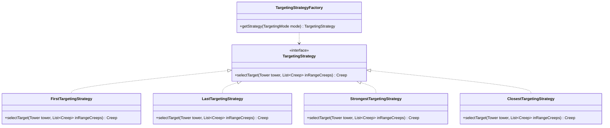

# TowerLab Class Design & Architecture Specification

## 1. Architectural Philosophy
The backend is structured into three clean, decoupled layers:
1. **Simulation Domain Engine (`com.towerlab.engine`):** A pure Java, framework-free deterministic simulation kernel. It has **no dependency on Spring or JPA**, enabling blazing fast in-memory execution, deterministic testing, and high-throughput batch parallelization.
2. **Analytics Engine (`com.towerlab.analytics`):** Orchestrates multi-threaded Monte Carlo simulation batches over parallel worker pools, aggregating statistical balance indicators.
3. **Application & Infrastructure Layer (`com.towerlab.service`, `entity`, `repository`, `controller`):** Handles REST interfaces, JPA database persistence, input validation, and transaction boundaries.

---

## 2. Package Architecture

```
com.towerlab/
├── TowerLabApplication.java               # Spring Boot entry point
├── config/
│   ├── CorsConfig.java                    # Frontend CORS configuration
│   └── DatabaseConfig.java                # JPA & Datasource properties
├── controller/
│   ├── LevelController.java               # /api/levels
│   ├── SimulationController.java          # /api/simulations/play, /batch
│   └── TowerConfigController.java         # /api/tower-configs
├── dto/
│   ├── ApiError.java
│   ├── PlaySimulationRequest.java
│   ├── PlaySimulationResponse.java
│   ├── BatchSimulationRequest.java
│   ├── BatchSimulationResponse.java
│   ├── TowerAnalyticsDto.java
│   └── LevelDto.java
├── entity/
│   ├── LevelEntity.java
│   ├── SimulationRunEntity.java
│   ├── BatchExperimentEntity.java
│   └── TowerConfigEntity.java
├── repository/
│   ├── LevelRepository.java
│   ├── SimulationRunRepository.java
│   ├── BatchExperimentRepository.java
│   └── TowerConfigRepository.java
├── service/
│   ├── LevelService.java
│   ├── SimulationService.java
│   └── AnalyticsService.java
├── engine/                                # PURE JAVA DOMAIN ENGINE
│   ├── GameSimulation.java                # Main simulation engine loop
│   ├── model/
│   │   ├── Grid.java                      # 12x8 tile matrix and collision
│   │   ├── Coordinate.java                # Point (x, y)
│   │   ├── PathWaypoint.java              # Polyline path waypoint
│   │   ├── Tower.java                     # Tower state and combat stats
│   │   ├── TowerType.java                 # CANNON, SNIPER, FROST
│   │   ├── Creep.java                     # Creep instance, HP, status effects
│   │   ├── CreepType.java                 # STANDARD, RUNNER, TANK, BOSS
│   │   ├── WaveDefinition.java            # Wave schedule
│   │   ├── PlayerAction.java              # Planned player command
│   │   └── SimulationOutcome.java         # VICTORY, DEFEAT
│   ├── targeting/
│   │   ├── TargetingStrategy.java         # Strategy interface
│   │   ├── FirstTargetingStrategy.java    # Farthest along path
│   │   ├── LastTargetingStrategy.java     # Closest to spawn
│   │   ├── StrongestTargetingStrategy.java# Highest HP
│   │   ├── ClosestTargetingStrategy.java  # Shortest Euclidean distance
│   │   └── TargetingStrategyFactory.java  # Strategy selector
│   └── events/
│       ├── SimulationEvent.java           # Base event record
│       ├── EventType.java                 # Event taxonomy enum
│       └── EventLogger.java               # Chronological event accumulator
└── analytics/
    ├── BatchSimulationRunner.java         # Concurrency executor
    └── BalanceMetricsCalculator.java      # Statistical metric aggregator
```

---

## 3. Design Patterns Applied

### 3.1 Strategy Pattern for Tower Targeting
Each targeting mode implements `TargetingStrategy`:



### 3.2 Pure Domain Deterministic Loop
`GameSimulation` maintains no external state or system clock dependencies:
- Takes `(LevelConfig, Seed, List<PlayerAction>)`.
- Instantiates a seeded `java.util.Random(seed)`.
- Advances discrete integer `tick` from 0 until terminal condition (`VICTORY`, `DEFEAT`, or maximum tick cutoff e.g. 5000).
- Emits an immutable list of `SimulationEvent`.

---

## 4. Concurrency & Batch Processing Design
For `POST /api/simulations/batch`:
1. The user requests $N$ runs (e.g. 100 runs).
2. `BatchSimulationRunner` leverages a pooled Java `ExecutorService` (or parallel streams utilizing CPU cores).
3. Each worker thread instantiates an independent `GameSimulation` with `seed = baseSeed + i`.
4. As simulations finish, `BalanceMetricsCalculator` aggregates:
   - Win Rate: $\frac{\text{wins}}{N} \times 100\%$
   - Tower Damage Share: $\frac{\sum \text{Damage}_{\text{TowerType}}}{\sum \text{Damage}_{\text{Total}}} \times 100\%$
   - Cost Efficiency: $\frac{\text{Total Damage}}{\text{Total Gold Spent}}$
   - Tower Utilization: $\frac{\text{Ticks Spent Firing}}{\text{Total Active Ticks}}$
5. The result is returned synchronously or saved to `batch_experiments` table.

