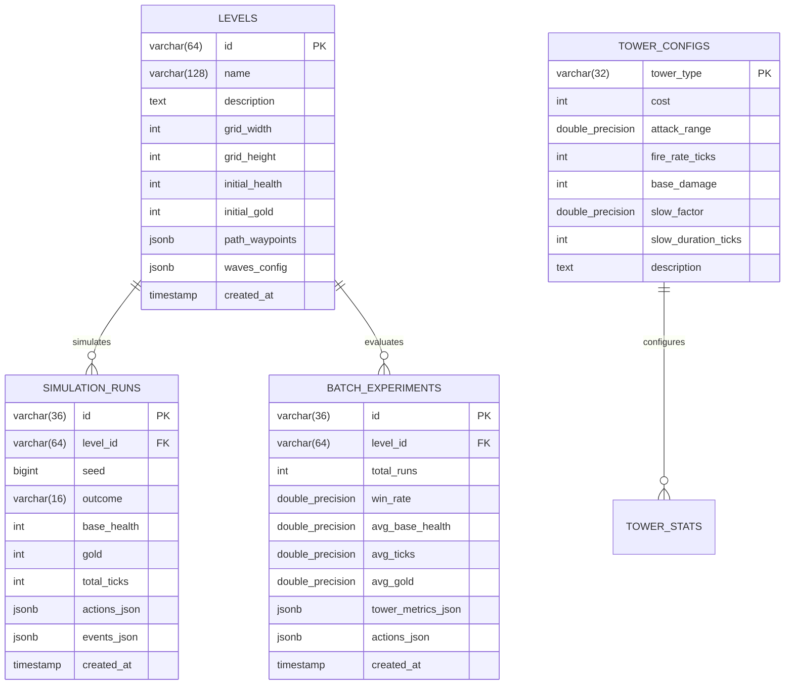

# TowerLab Database Schema Specification

## 1. Architectural Decisions

1. **Storage Engine:** PostgreSQL 15+ / 18 (with H2 in-memory compatibility for automated testing).
2. **Hybrid Relational + Semi-Structured Design:**
   - **Structured Relational:** Core metadata, levels, simulation summaries, analytics experiments, and tower definitions are stored in normalized relational tables with strong primary key, foreign key, and unique constraints.
   - **Semi-Structured (JSONB):** The player's build plan (`actions`), level waypoint paths, wave composition, and the fine-grained simulation event stream (`events`) are stored using JSON / JSONB. This allows the backend to store 10,000+ tick events in a single highly-optimized column per run without creating millions of tiny relational row overheads, while preserving fast querying and JSON serialization for REST API consumption.
3. **Auditability & Reproducibility:**
   - Every simulation record stores the exact `seed`, input `plan_json`, resulting `events_json`, outcome (`VICTORY` or `DEFEAT`), and timing metrics to guarantee 100% reproducible historical verification.

---

## 2. Entity-Relationship Diagram



---

## 3. Relational Table Specifications (PostgreSQL DDL)

### 3.1 `levels`
Stores the map layout, entrance/exit coordinates, waypoint path, starting resources, and wave schedules.

```sql
CREATE TABLE levels (
    id VARCHAR(64) PRIMARY KEY,
    name VARCHAR(128) NOT NULL,
    description TEXT,
    grid_width INT NOT NULL DEFAULT 12,
    grid_height INT NOT NULL DEFAULT 8,
    initial_health INT NOT NULL DEFAULT 100,
    initial_gold INT NOT NULL DEFAULT 350,
    path_waypoints JSONB NOT NULL,
    waves_config JSONB NOT NULL,
    created_at TIMESTAMP WITH TIME ZONE DEFAULT CURRENT_TIMESTAMP
);

CREATE INDEX idx_levels_created_at ON levels(created_at);
```

#### JSON Structure: `path_waypoints`
```json
[
  {"x": 0, "y": 3},
  {"x": 4, "y": 3},
  {"x": 4, "y": 1},
  {"x": 8, "y": 1},
  {"x": 8, "y": 6},
  {"x": 11, "y": 6}
]
```

#### JSON Structure: `waves_config`
```json
[
  {
    "waveNumber": 1,
    "delayTicks": 30,
    "creeps": [
      {"type": "STANDARD", "count": 6, "intervalTicks": 15},
      {"type": "RUNNER", "count": 3, "intervalTicks": 10}
    ]
  }
]
```

---

### 3.2 `simulation_runs`
Stores the result and chronological event log of individual simulation runs triggered by `POST /api/simulations/play`.

```sql
CREATE TABLE simulation_runs (
    id VARCHAR(36) PRIMARY KEY,
    level_id VARCHAR(64) NOT NULL REFERENCES levels(id) ON DELETE CASCADE,
    seed BIGINT NOT NULL,
    outcome VARCHAR(16) NOT NULL, -- 'VICTORY' or 'DEFEAT'
    base_health INT NOT NULL,
    gold INT NOT NULL,
    total_ticks INT NOT NULL,
    actions_json JSONB NOT NULL,
    events_json JSONB NOT NULL,
    created_at TIMESTAMP WITH TIME ZONE DEFAULT CURRENT_TIMESTAMP
);

CREATE INDEX idx_sim_runs_level_id ON simulation_runs(level_id);
CREATE INDEX idx_sim_runs_created_at ON simulation_runs(created_at);
CREATE INDEX idx_sim_runs_outcome ON simulation_runs(outcome);
```

---

### 3.3 `batch_experiments`
Records multi-run balance analyzer sessions initiated via `POST /api/simulations/batch`.

```sql
CREATE TABLE batch_experiments (
    id VARCHAR(36) PRIMARY KEY,
    level_id VARCHAR(64) NOT NULL REFERENCES levels(id) ON DELETE CASCADE,
    total_runs INT NOT NULL,
    win_rate DOUBLE PRECISION NOT NULL,
    avg_base_health DOUBLE PRECISION NOT NULL,
    avg_ticks DOUBLE PRECISION NOT NULL,
    avg_gold DOUBLE PRECISION NOT NULL,
    tower_metrics_json JSONB NOT NULL,
    actions_json JSONB NOT NULL,
    created_at TIMESTAMP WITH TIME ZONE DEFAULT CURRENT_TIMESTAMP
);

CREATE INDEX idx_batch_exp_level_id ON batch_experiments(level_id);
CREATE INDEX idx_batch_exp_created_at ON batch_experiments(created_at);
```

#### JSON Structure: `tower_metrics_json`
```json
{
  "CANNON": {
    "totalBuilt": 3,
    "totalDamageDealt": 4820,
    "damageSharePercentage": 52.4,
    "totalKills": 18,
    "killSharePercentage": 47.3,
    "costEfficiency": 16.06,
    "utilizationPercentage": 68.2
  },
  "SNIPER": {
    "totalBuilt": 1,
    "totalDamageDealt": 3100,
    "damageSharePercentage": 33.7,
    "totalKills": 12,
    "killSharePercentage": 31.6,
    "costEfficiency": 20.67,
    "utilizationPercentage": 45.0
  },
  "FROST": {
    "totalBuilt": 1,
    "totalDamageDealt": 1280,
    "damageSharePercentage": 13.9,
    "totalKills": 8,
    "killSharePercentage": 21.1,
    "costEfficiency": 10.24,
    "utilizationPercentage": 82.5
  }
}
```

---

### 3.4 `tower_configs`
Contains canonical stats for tower balance, editable without redeploying code.

```sql
CREATE TABLE tower_configs (
    tower_type VARCHAR(32) PRIMARY KEY,
    cost INT NOT NULL,
    attack_range DOUBLE PRECISION NOT NULL,
    fire_rate_ticks INT NOT NULL,
    base_damage INT NOT NULL,
    slow_factor DOUBLE PRECISION NOT NULL DEFAULT 0.0,
    slow_duration_ticks INT NOT NULL DEFAULT 0,
    description TEXT
);

INSERT INTO tower_configs (tower_type, cost, attack_range, fire_rate_ticks, base_damage, slow_factor, slow_duration_ticks, description) VALUES
('CANNON', 100, 2.5, 10, 45, 0.0, 0, 'Reliable mid-range physical projectile with steady DPS.'),
('SNIPER', 150, 6.0, 25, 140, 0.0, 0, 'Long-range precision rifle delivering massive burst damage.'),
('FROST',  125, 2.0, 15, 15, 0.40, 20, 'Frost emitter that slows enemy advance by 40% for 20 ticks.');
```

---

## 4. Migration Strategy
Flyway migration scripts will be located at `backend/src/main/resources/db/migration/`:
- `V1__init_schema.sql`: Table creation, constraints, indexes.
- `V2__seed_default_levels.sql`: Insertion of baseline Level 1 (Tutorial Waypoints) and Level 2 (Dual Bend Challenge).

